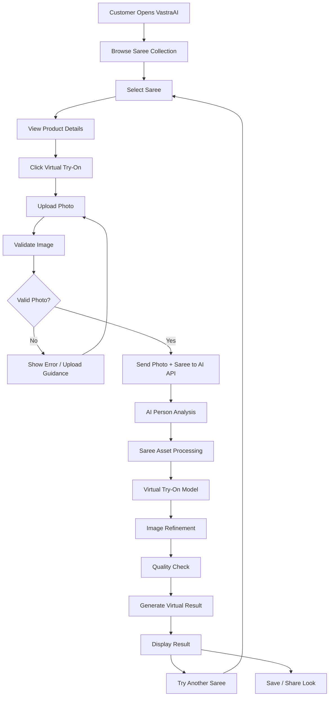
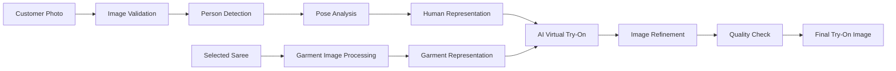
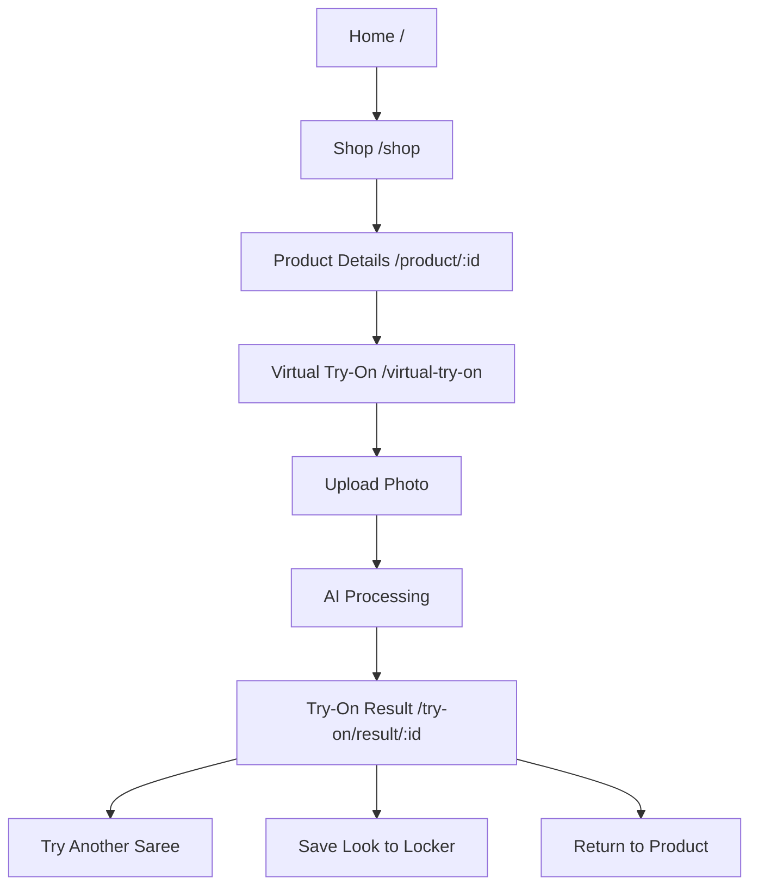

# VastraAI — System Architecture & Workflow Specifications

## 1. Customer Journey Flowchart



---

## 2. AI Processing Pipeline Flowchart



---

## 3. Website Page Routing & Hierarchy



---

## 4. Multi-Stage Try-On Architecture Breakdown

```text
┌─────────────────┐       ┌────────────────────────┐       ┌───────────────────────┐
│                 │  POST │                        │       │                       │
│  React Frontend │ ────> │  FastAPI Backend API   │ ────> │  TryOnService Queue   │
│  (/virtual-try) │       │  (/api/virtual-try-on) │       │  (Asyncio Background) │
│                 │ <──── │                        │       │                       │
└─────────────────┘ 200 OK└────────────────────────┘       └───────────┬───────────┘
         │                                                             │
         │ Poll status                                                 ▼
         │ (/api/virtual-try-on/:id)                     ┌───────────────────────────┐
         ▼                                               │                           │
┌─────────────────┐                                      │ VirtualTryOnProvider      │
│                 │                                      │ (Demo / Real IDM-VTON)    │
│  TryOnResult    │ <────────────────────────────────────┤                           │
│  (/try-on/...)  │            Completed Job             └───────────────────────────┘
└─────────────────┘
```
